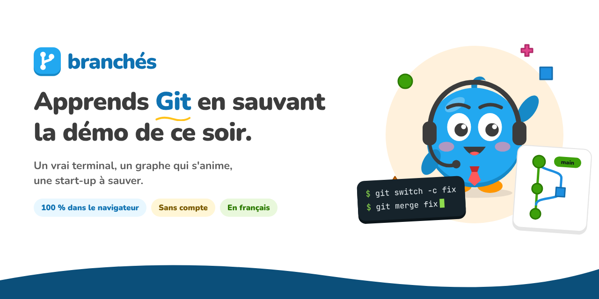
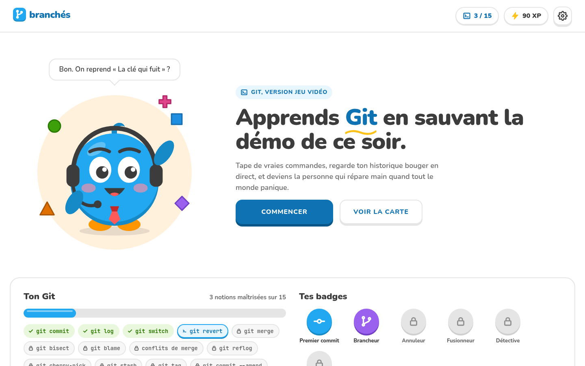
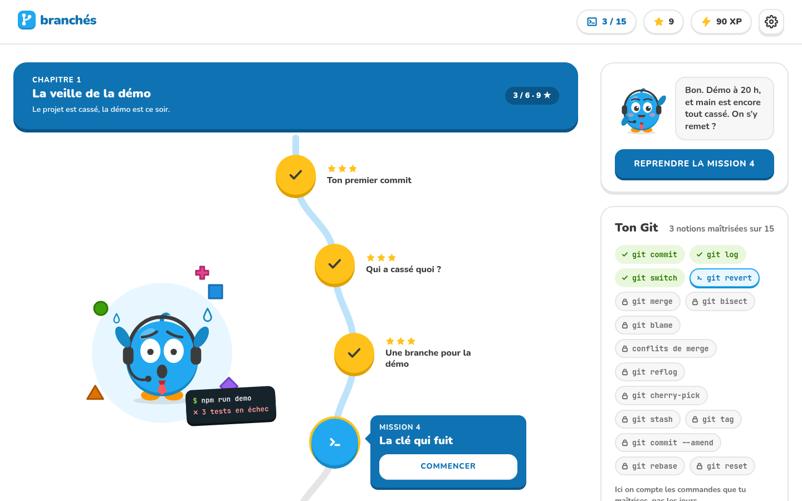
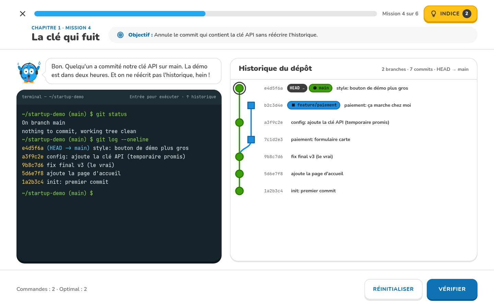
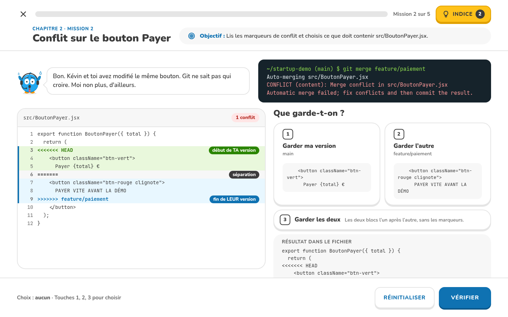
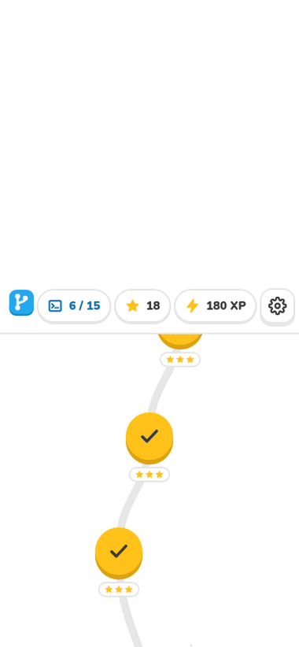
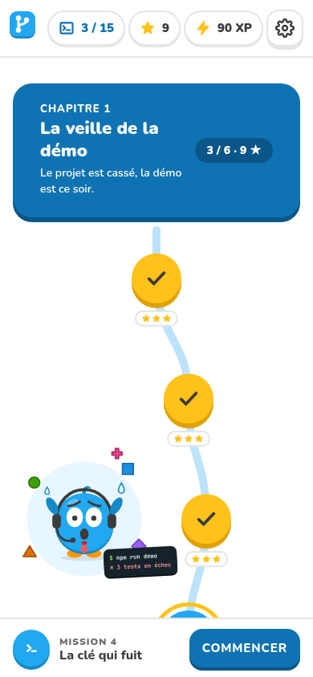

<p align="center">
  
</p>

<p align="center">
  <a href="https://github.com/a2zrr/branches/actions/workflows/ci.yml"></a>
  
  
  
  <a href="LICENSE"></a>
</p>

**Branchés** est un jeu pour apprendre Git dans le navigateur. On tape de vraies commandes dans un terminal, et le graphe des commits réagit en direct, avec des animations. Chaque mission est une galère chez Pivot & Co, une start-up dont la démo est ce soir. Hédi, le chef de projet, panique. À toi de réparer `main`.

> *English summary — Branchés is a browser game that teaches Git. You type real Git commands in a terminal and watch the commit graph animate live. Story-driven missions, stars, XP, no account, no backend: everything runs and stays in your browser. The interface is in French; Git output is in English, like the real thing.*

## Sommaire

- [Captures](#captures)
- [Ce que fait le jeu](#ce-que-fait-le-jeu)
- [Lancer le projet](#lancer-le-projet)
- [Comment c'est construit](#comment-cest-construit)
- [Ajouter une mission](#ajouter-une-mission)
- [Qualité](#qualité)
- [Licence](#licence)

## Captures

| Accueil | Carte des missions |
|---|---|
|  |  |
| **Une mission : terminal et graphe** | **Conflit de merge** |
|  |  |

<p align="center">
  
  &nbsp;&nbsp;
  
</p>

## Ce que fait le jeu

- **Un vrai terminal.** On tape `git commit`, `git log`, `git switch`, `git revert`, `git merge`, `git bisect`… La sortie ressemble à celle de Git. Les fautes de frappe reçoivent une suggestion : « Git a deviné ce que tu voulais dire ».
- **Un graphe vivant.** Chaque commande anime le graphe : nouveaux commits, déplacement de HEAD, fusions, reverts. Chaque branche a sa couleur **et** sa forme (cercle, carré, losange…) : on la reconnaît même sans les couleurs.
- **Des conflits de merge à résoudre**, version par version, avec un aperçu du résultat.
- **Une histoire.** Des chapitres, des missions courtes, des indices à la demande. La suite de la carte reste cachée sous les nuages jusqu'à la fin du chapitre.
- **Une progression qui mesure ce qu'on sait faire.** Des étoiles selon le nombre de commandes utilisées par rapport à la solution optimale, de l'XP, les notions maîtrisées (« Ton Git ») et des badges. Pas de série de jours, pas de pression.
- **Aucun compte, aucun serveur.** La partie reste dans le navigateur (`localStorage`). On peut l'exporter et l'importer.
- **Pour tout le monde.** Thème clair, sombre ou automatique, navigation complète au clavier, contraste AA, animations réduites si le système le demande. La carte s'adapte au téléphone.

Aujourd'hui : **3 chapitres, 7 missions jouables** et 8 autres en préparation.

## Lancer le projet

Il faut **Node.js 20** ou plus récent.

```bash
git clone https://github.com/a2zrr/branches.git
cd branches
npm ci
npm run dev
```

Le jeu s'ouvre sur `http://localhost:5173`.

| Commande | Rôle |
|---|---|
| `npm run dev` | serveur de développement |
| `npm run build` | version de production dans `dist/` |
| `npm run preview` | sert la version de production |
| `npm run verif` | lint, types et tests unitaires (à lancer avant chaque commit) |
| `npm run test` | tests unitaires (Vitest) |
| `npm run test:e2e` | tests de bout en bout et d'accessibilité (Playwright + axe) |

## Comment c'est construit

| Domaine | Choix |
|---|---|
| Interface | React, TypeScript strict, Vite, React Router |
| Styles | CSS Modules et variables CSS (design tokens clair et sombre), aucune librairie de composants |
| État | Zustand avec persistance locale, schémas validés par zod |
| Animations | Motion, uniquement `transform` et `opacity` |
| Tests | Vitest et Testing Library, Playwright et axe-core |

```
src/
├── engine/      moteur Git simulé : TypeScript pur, sans React ni DOM
├── game/        règles du jeu : déblocage, étoiles, XP, notions, chapitres visibles
├── data/        chapitres, missions et badges en JSON
├── components/  composants d'interface (graphe, terminal, carte, mascotte…)
├── exercises/   exercices de conflit de merge
├── screens/     accueil, carte, mission, fin de mission
├── styles/      tokens et styles globaux
└── test/        utilitaires de test
```

**Le moteur Git** reproduit le comportement de Git sur un dépôt en mémoire : commits, branches, HEAD détaché, merge (avance rapide et commit de fusion), conflits, revert, bisect… Il est **immuable** : chaque commande renvoie un nouveau dépôt et une liste d'**événements** (`commitCree`, `headDeplace`, `fusion`…). L'interface se contente de les animer. Le moteur n'a aucune dépendance à React, ce qui permet de le tester entièrement en isolation.

**Le graphe** place les commits lui-même : une colonne par branche, une rangée par commit, des liens droits, de départ ou de fusion, puis un motif (plein, tirets, pointillés) au-delà de six branches.

## Ajouter une mission

Une mission, c'est **un fichier JSON** dans `src/data/missions/` : l'histoire, l'objectif, l'état de départ du dépôt, les indices, les conditions de réussite et le nombre optimal de commandes. Il n'y a rien à coder. Le format complet est décrit dans [docs/ajouter-une-mission.md](docs/ajouter-une-mission.md), et chaque fiche est validée au chargement.

## Qualité

- Tests unitaires du moteur, commande par commande, et des règles de jeu.
- Chaque mission est rejouée automatiquement avec sa solution de référence.
- Tests de bout en bout sur les parcours principaux, en clair et en sombre, sur PC et sur téléphone.
- Audit d'accessibilité axe sur les écrans principaux (carte, paramètres, mission).
- Intégration continue GitHub Actions à chaque push.

## Licence

[MIT](LICENSE) © 2026 Abdel hak EZZERBOUTI — conçu et développé par [@a2zrr](https://github.com/a2zrr).
